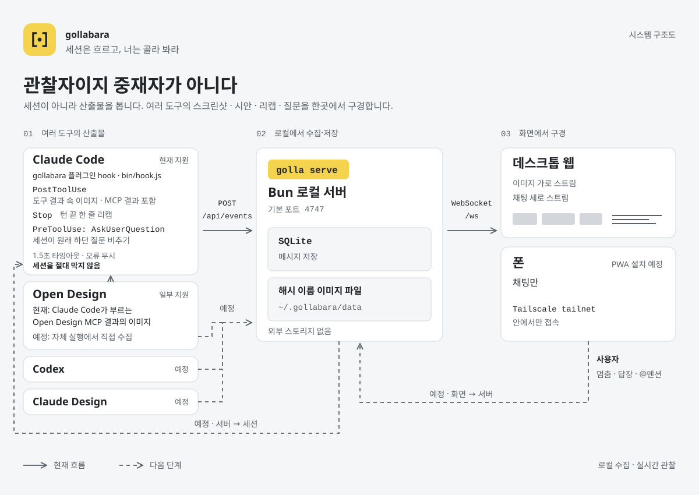

# gollabara

**English** | [한국어](README.ko.md)

> Your sessions stream. You pick, you look.

A local web app that gathers only the **artifacts** your Open Design, Claude Code, Codex, and Claude Design sessions produce (screenshots, design mockups, end-of-turn recaps, and the questions sessions ask) into a single stream. Keep it on a side monitor or your phone, watch it flow, and step in only when you need to.

<picture>
  <source media="(prefers-color-scheme: dark)" srcset="docs/architecture-dark.svg">
  
</picture>

## Why

As a UX engineer building client apps, I constantly make decisions and give feedback while looking at screenshots and mockups. At the same time, I run client development sessions and need to watch them and step in now and then. That work spans Open Design, Claude Code, Codex, and Claude Design. What I needed was not a dashboard that pulls every session into one place, but **a view that follows the flow through its artifacts**.

## Design philosophy

### Watch the artifacts, not the sessions

gollabara narrows what you watch from sessions to artifacts. It doesn't mirror full transcripts, and it has no per-session tabs or split panes. Artifacts from every tool flow together in one chronological stream, and a session is just a sender name.

### An observer, not a mediator

gollabara never asks a session for approval and never invents questions. It mirrors a question only when the session's own workflow was going to ask it anyway. No alarm colors, no big buttons pushing you to decide.

### Sessions don't know they're being watched

You don't change a session's prompt or workflow for this app. Sessions work as usual, and hooks pick up what they produce along the way. Capturing never stops or slows a session. If the server is off, nothing happens at all.

### Judgment stays with your eyes

Whether a screen is right is for a person to judge, not a model. So gollabara never judges an artifact: it shows screenshots and mockups exactly as sessions captured them. The image is the star, so every column takes the image's own aspect ratio, uncropped.

### A quiet surface, a single signal

It sits beside you all day, so the surface stays quiet, like a near-monochrome developer tool. A single yellow marks only three things: the logo, what you picked, and the main action. The symbol, an open viewfinder, stands for observing; the dot inside it is the moment you pick. The full rules live in [DESIGN.md](DESIGN.md).

### Two flows, two directions

On the desktop, images flow sideways while recaps and questions flow down. Pick one and its counterpart lights up on the other side. On a phone only the chat remains, and you tap an image to see it full size.

### Stays on your machine

Artifacts are stored only on your machine and never go to third-party storage. Remote viewing is designed to stay inside your Tailscale tailnet, never on the public internet.

The server listens only on this machine and, when Tailscale is up, on its tailnet address, so other devices on the same Wi-Fi can't open it. To watch from your phone, join it to the same tailnet and open `http://<your machine's tailnet name or 100.x address>:4747`. Start Tailscale before the server; an address that comes up later is picked up on the next restart. `GOLLABARA_HOST` overrides the listen addresses (comma-separated, e.g. `0.0.0.0`), at your own risk. The server answers only to its own addresses and names, so a page in your browser can't reach it under another name; add any other name you open it by (a reverse proxy, say) to `GOLLABARA_ALLOWED_HOSTS`.

## The name

gollabara spells out the Korean 골라 봐라 as it sounds, and it reads two ways. Said in one breath, it means "go on, pick one." Split apart, it becomes 골라, 봐라: "pick, and look." Both are what the app asks of you: let your sessions stream, watch the artifacts and decisions they produce, check them, and give feedback when something needs you.

## Where it stands

Early stage. What works today:

- **Claude Code**, including Open Design runs started from it: images, recaps, and questions flow into the stream.
- **Stepping in:** reply to a session, about one image or in general. Your feedback reaches it at its next step, and an idle session wakes up for it. Mute a session, or narrow the view to one.
- **Your phone over the tailnet:** open the stream from any device on your Tailscale tailnet.

What comes next, and in what order, is in [docs/ROADMAP.md](docs/ROADMAP.md): remote access through Tailscale Serve with a home-screen app, notifications when a session asks something, then Codex. Antigravity and other harnesses follow after the MVP.

## Try it

Requires [bun](https://bun.sh) 1.3 or later.

```bash
bunx gollabara setup     # once it is on npm
bunx gollabara doctor    # what is and isn't working
```

`setup` installs gollabara under `~/.gollabara`, starts the server as a login service on macOS (http://localhost:4747), and installs the plugin into Claude Code when `claude` is on your PATH. Run it again any time; `bunx gollabara update` refreshes everything and `bunx gollabara uninstall` removes it (`--keep-data` keeps your messages and images).

From a checkout, until the npm package is published:

```bash
bun install && bun run build
bun src/cli.ts setup     # or: bun src/cli.ts serve, without the login service
```

Your feedback reaches a session even while it sits idle: the plugin wakes it, with no launch flag.

For development and configuration, see [AGENTS.md](AGENTS.md).

## License

MIT
